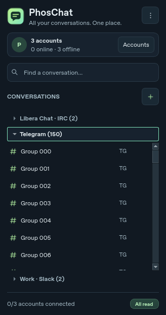
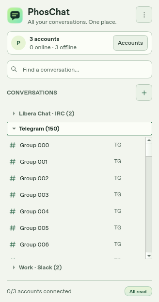

<div align="center">


# PhosChat

**All your conversations. One place.**

[](https://github.com/minibota/phoschat/releases)
[](https://github.com/minibota/phoschat/actions/workflows/ci.yml)
[](https://github.com/minibota/phoschat/actions/workflows/release.yml)
[](LICENSE)

A native desktop messenger with a compact conversation list, independent chat windows and a phosphor glow. A sibling project to [Phosrack](https://github.com/minibota/phosrack), built with C++20 and Qt Widgets.

[Downloads](https://github.com/minibota/phoschat/releases) · [IRC directory](docs/irc-directory.md) · [Telegram setup](docs/telegram.md) · [Slack setup](docs/slack.md) · [Issues](https://github.com/minibota/phoschat/issues)

</div>

## A small window for everything. A separate window for each chat.

| Dark phosphor | Light phosphor |
| --- | --- |
|  |  |

Actual Qt Widgets captures with local test data. The open account contains 150 groups; its list scrolls while the other account headers stay visible. Switch themes under **Settings → Appearance**. The choice applies to open windows and persists when you restart.

[See independent conversation windows in the v0.2.0 local IRC demo](docs/images/phoschat-dark.png).

## What you can do

The **v0.2.2 preview** adds paginated Telegram history, file sending, contact profiles and presence, and native Linux notifications.

- Double-click any conversation to open or focus its own native window. PhosChat remembers window size, position and which conversations were open.
- Switch accounts through an accordion that keeps the other account headers visible while the open list scrolls. See online, offline and connecting totals at a glance.
- Find unread conversations first, search locally, pin favorites, create groups and mute individual chats.
- Read earlier Telegram messages with **Load older messages**. Your reading position stays in place as more history arrives, and restored conversations load after their account reconnects.
- See Telegram chat photos and open available profile details by clicking a conversation's name or photo. Direct chats show contact presence when the network reports it; unavailable or private presence stays unknown.
- Send attachments in supported Telegram and Slack conversations. Delivery and read labels use the service's actual confirmations; Slack and IRC do not supply recipient read receipts.
- Receive desktop notifications and open the matching conversation from an alert. Linux notifications also work without a visible system tray.
- Choose a popular IRC network or enter a custom server, and connect to several networks at once. Discover live channels, explore curated suggestions by topic, and see whether joining a channel succeeded.
- Keep IRC history on your computer. Telegram and Slack message bodies stay in memory. Save supported credentials in the system keychain, or keep them for the current run.

| Protocol | Status | Available in this build |
| --- | --- | --- |
| **IRC / IRCv3** | Available | TLS/SASL, channels and private messages, participants, network-local nick presence, WHOIS profiles, mentions, reconnect and local history. |
| **Telegram** | Preview | Official TDLib, phone sign-in, direct chats and main/archived groups, paginated history, chat photos, profiles, contact presence, text and attachment sending, reported delivery/read states. |
| **Slack** | Preview | Official Web API, approved workspace accounts, channels and DMs, text and file sending, profiles and active/away presence, rate-limited recent history. Optional configured browser sign-in. |
| **Matrix** | Later | Planned after the Telegram and Slack integrations mature. |

Configured Telegram builds use PhosChat's application identity, so users sign in to their own account without creating an API application. Slack requires an approved workspace application. Shared Slack browser sign-in additionally depends on a configured and deployed HTTPS authorization service; it is optional, and advanced workspace setup remains available. Build variables do not deploy that service or grant workspace approval.

Telegram broadcast channels, secret chats and protected/auto-deleting message content remain excluded. Attachments are described in history; downloading and playing them inside PhosChat is not implemented. Slack history remains rate-limited, and Slack threads are outside this preview. Automated adapter, UI and local service tests do not replace live authorization and sustained messaging checks. See the [Telegram](docs/telegram.md) and [Slack](docs/slack.md) guides for exact scope and setup.

## Install

Use the [releases page](https://github.com/minibota/phoschat/releases) to check availability and download the package for your system. Packages target 64-bit Intel and AMD machines.

| Platform | Package | Install |
| --- | --- | --- |
| Debian 13 | `.deb` | `sudo apt install ./phoschat_*.deb` |
| Fedora 45 | `.rpm` | `sudo dnf install ./phoschat-*.rpm` |
| Linux with Flatpak | `.flatpak` | `flatpak install --user ./phoschat-*.flatpak` |
| Windows x64 | `.exe` | Run the setup executable. |

The macOS preview job checks compilation, the IRC parser and plain loopback connection, and the other test suites. Trusted IRC TLS with Secure Transport and a signed macOS installer remain future work. See [packaging](docs/packaging.md) for prerequisites, unsigned package details and checksums.

## Start with IRC

1. Open **Accounts**. Choose a suggested network (or **Custom server**), enter your nickname, then choose **Save & connect**. TLS is enabled by default.
2. Open **+ → Discover IRC channels**. Use **Live directory** for channels on your connected server or **Suggestions** to explore by topic. You can also enter a channel directly using its prefix, such as `#lobby`.
3. Double-click a conversation to open it. The composer accepts `/join`, `/part`, `/msg`, `/me`, `/nick` and `/names` in IRC conversations.

Run `python3 tests/demo_irc_server.py` for a local demo. Choose **Custom server**, enter `127.0.0.1:16667`, turn TLS off for this loopback demo, then join `#lobby`, `#desktop` or `#off-topic`.

## Build from source

Use a C++20 compiler, CMake 3.22+, Ninja and Qt 6.8+ with Core, Gui, Widgets, Network, SQL, QSQLITE and a TLS backend. Linux also needs Qt DBus. Qt Test is needed for tests; `dbus-run-session` enables isolated Linux notification checks. QtKeychain adds system credential storage.

On Debian 13:

```sh
sudo apt install g++ cmake ninja-build qt6-base-dev libqt6sql6-sqlite qtkeychain-qt6-dev dbus-daemon
cmake --preset debug
cmake --build --preset debug
ctest --preset debug
./build/debug/phoschat
```

Use the `release` preset for an optimized build. On Windows, run from an MSVC developer shell with a matching Qt kit. On macOS, launch with `open build/debug/phoschat.app`. Set `CMAKE_PREFIX_PATH` if CMake cannot find the Qt kit.

The optional [Slack HTTPS service](services/slack-oauth/README.md) has separate local tests: `python3 -m unittest discover -s services/slack-oauth -v`. These use fixtures and do not authorize real accounts. Release configuration is documented in [packaging](docs/packaging.md).

[Architecture](docs/architecture.md) · [Protocol research](docs/protocols.md) · [Interface design](docs/ui-design.md) · [Roadmap](docs/roadmap.md)

PhosChat is licensed under [GPL-3.0-or-later](LICENSE). This independent client uses the Telegram API through official TDLib and the Slack Web API. The names and marks of the respective services belong to their owners.
