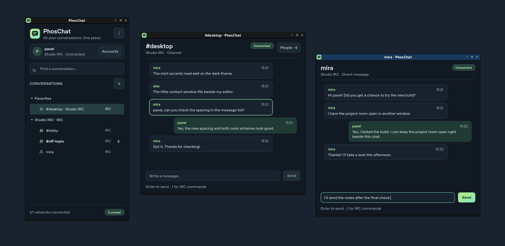

<div align="center">


# PhosChat

**All your conversations. One place.**

[](https://github.com/minibota/phoschat/releases)
[](https://github.com/minibota/phoschat/actions/workflows/ci.yml)
[](https://github.com/minibota/phoschat/actions/workflows/release.yml)
[](LICENSE)

A native desktop messenger with a compact conversation list, independent chat windows and a phosphor glow. A sibling project to [Phosrack](https://github.com/minibota/phosrack), built with C++20 and Qt Widgets.

[Downloads](https://github.com/minibota/phoschat/releases) · [IRC directory](docs/irc-directory.md) · [Telegram setup](docs/telegram.md) · [Slack setup](docs/slack.md) · [Issues](https://github.com/minibota/phoschat/issues)

</div>

## A small window for everything. A separate window for each chat.



The screenshots show the running desktop app connected to the local IRC demo. Switch between **Dark** and **Light** under **Settings → Appearance**. The choice applies to open windows and persists when you restart. [View the light theme](docs/images/phoschat-light.png)

## What you can do

- Double-click any conversation to open or focus its own native window. PhosChat remembers window size, position and which conversations were open.
- Search your conversations, pin favorites, create groups and mute individual chats.
- Connect to several IRC networks at once. Discover live channels on your connected server, or explore a curated directory of networks and channels by topic.
- Keep IRC history on your computer. Telegram and Slack message bodies stay in memory. Save supported credentials in the system keychain, or keep them for the current run.

| Protocol | Status | Available in this build |
| --- | --- | --- |
| **IRC / IRCv3** | Available | TLS and SASL, channels, private messages, participants, mentions, reconnect and local history. |
| **Telegram** | Preview | Official TDLib, phone sign-in in configured builds, direct chats, main and archived groups, text and recent history. v0.2.0 installers still require your own API ID/hash. |
| **Slack** | Preview | Official Web API, browser PKCE for an approved workspace app or an authorized user token, channel and DM discovery, text and rate-limited history for the last opened conversation. |
| **Matrix** | Later | Planned after the Telegram and Slack integrations mature. |

Configured Telegram builds use PhosChat's application identity, so users sign in to their own account without creating an API application. Slack requires an approved workspace application. The previews have automated adapter tests. Live sign-in and sustained messaging in an actual Telegram account or approved Slack workspace are separate verification steps. Telegram broadcast channels, secret chats, files and Slack threads are outside this preview. See the [Telegram](docs/telegram.md) and [Slack](docs/slack.md) guides for supported scope and the differences from the published v0.2.0 installers.

## Install

Use the [releases page](https://github.com/minibota/phoschat/releases) to check availability and download the package for your system. Packages target 64-bit Intel and AMD machines.

| Platform | Package | Install |
| --- | --- | --- |
| Debian 13 | `.deb` | `sudo apt install ./phoschat_*.deb` |
| Fedora 45 | `.rpm` | `sudo dnf install ./phoschat-*.rpm` |
| Linux with Flatpak | `.flatpak` | `flatpak install --user ./phoschat-*.flatpak` |
| Windows x64 | `.exe` | Run the setup executable. |

The macOS preview job checks compilation, the IRC parser and plain loopback connection, and the other five test suites. Trusted IRC TLS with Secure Transport and a signed macOS installer remain future work. See [packaging](docs/packaging.md) for prerequisites, unsigned package details and checksums.

## Start with IRC

1. Open **Accounts**. Add an IRC account with a nickname, then choose **Save & connect**. TLS is enabled by default.
2. Open **+ → Discover IRC channels**. Use **Live directory** for channels on your connected server or **Suggestions** to explore by topic. You can also enter a channel directly using its prefix, such as `#lobby`.
3. Double-click a conversation to open it. The composer accepts `/join`, `/part`, `/msg`, `/me`, `/nick` and `/names` in IRC conversations.

Run `python3 tests/demo_irc_server.py` for a local demo. Add `127.0.0.1:16667` as an IRC server, turn TLS off for this loopback demo, then join `#lobby`, `#desktop` or `#off-topic`.

## Build from source

Use a C++20 compiler, CMake 3.22+, Ninja and Qt 6.8+ with Core, Gui, Widgets, Network, SQL, QSQLITE and a TLS backend. Qt Test is needed for tests. QtKeychain adds system credential storage.

On Debian 13:

```sh
sudo apt install g++ cmake ninja-build qt6-base-dev libqt6sql6-sqlite qtkeychain-qt6-dev
cmake --preset debug
cmake --build --preset debug
ctest --preset debug
./build/debug/phoschat
```

Use the `release` preset for an optimized build. On Windows, run from an MSVC developer shell with a matching Qt kit. On macOS, launch with `open build/debug/phoschat.app`. Set `CMAKE_PREFIX_PATH` if CMake cannot find the Qt kit.

[Architecture](docs/architecture.md) · [Protocol research](docs/protocols.md) · [Interface design](docs/ui-design.md) · [Roadmap](docs/roadmap.md)

PhosChat is licensed under [GPL-3.0-or-later](LICENSE). This independent client uses the Telegram API through official TDLib and the Slack Web API. The names and marks of the respective services belong to their owners.
