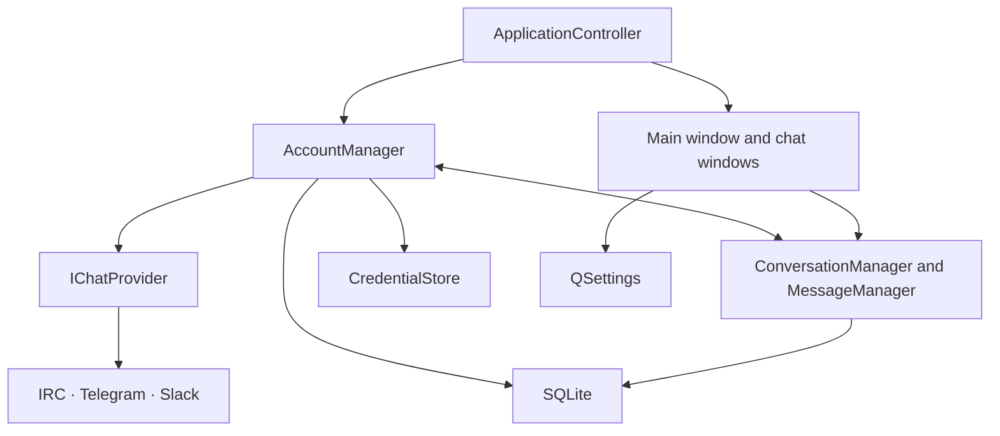

# PhosChat architecture

## Design decisions

| Decision | Approach | Reason and consequence |
| --- | --- | --- |
| Native desktop shell | Qt Widgets, small contact window and separate top-level chat windows | Widgets gives native window management and a direct path to a lightweight C++ desktop app. The model survives closing its chat window. |
| IRC implementation | A standalone asynchronous Qt Network provider with a bounded IRC frame decoder | The core owns account lifecycle and history. A Quassel or KVIrc core import would add existing UI, session, persistence or licensing constraints. The IRC adapter owns the protocol work that reuse would otherwise supply. |
| Build floor | C++20, Qt 6.8 and CMake 3.22 | Qt 6.8 is the tested distribution baseline. Core dependencies are Qt Base modules, with optional QtKeychain. |
| Local state | Qt SQL with SQLite, QSettings and a system keychain | SQLite stores account metadata, IRC history, local conversation state and read counts. QSettings stores window preferences. Credentials use OS-backed QtKeychain or remain in memory for the process lifetime. |
| Telegram application identity | Official-build API identity supplied by release secrets; manual identity behind an advanced setting | Regular users only authorize their own Telegram account. Existing custom identities remain unchanged. Application values embedded in binaries are extractable and do not protect local sessions. |
| Telegram session encryption | Random 256-bit key per profile, held in the system keychain | Versioned credential records migrate v0.2.0 profiles with a temporary legacy-key fallback persisted before TDLib opens the profile. No key is stored in SQLite. |
| License | GPL-3.0-or-later | The published source uses the same license as Phosrack. Each bundled dependency retains its own terms. |

## Runtime

- **ApplicationController** opens the profile, builds the service graph and coordinates shutdown. A per-profile lock prevents simultaneous writers with independent caches.
- **AccountManager** owns one provider instance per account, loads secrets on demand and reconnects after transport errors with backoff from 2 to 60 seconds. A manual disconnect cancels the retry. TLS or authentication failures require user action.
- **ConversationManager** owns membership and the local catalog. Channel membership is transient. A channel becomes eligible for automatic rejoin after the server confirms the initial JOIN. Favorites, group names, mute flags and unread counts persist.
- **MessageManager** routes commands and messages, deduplicates provider IDs, persists messages and unread changes atomically, and publishes new messages to the view. The provider emits the local outgoing event when it sends a message, or uses the server echo when that capability is negotiated.
- **WindowManager** keys top-level windows by conversation ID. Chat windows attach to independent controllers and message models. Moving that binding to a tab host later can preserve the underlying state.
- **NotificationManager** uses the system tray when available. Notification text indicates a message or mention without including message contents. Desktop permissions and tray support govern delivery.

## Boundaries and invariants

Each account receives a locally generated UUID. Conversation keys are pairs of account UUID and provider-scoped ID. Message keys add the message ID within that conversation. IRC nick and channel folding follows the network's advertised case mapping. The account endpoint is immutable after creation to isolate old history and secrets from new network identities. The SQLite foreign keys cascade when an account is removed. SQLite stores no credentials.

The IRC adapter drives DNS, TLS, registration, SASL and network I/O through Qt's asynchronous socket events. It enforces IRC frame bounds and treats incoming message content as plain text. The UI thread currently performs short synchronous SQLite operations against the local file. Move history paging and high-volume ingestion to a dedicated storage worker when a provider introduces sustained backfill.

The provider contract routes IRC commands, Telegram authorization challenges and Slack browser authorization through the same account manager. Conversation windows request remote history on demand. Telegram and Slack message bodies stay in a session cache, while SQLite retains IRC history and local conversation metadata. Telegram session storage remains under TDLib control. Resumable cursors, deeper history paging and encrypted-event placeholders remain future work. An IRC connection has no implied delivery receipts, global presence or server history. See [protocols.md](protocols.md) for the provider-specific constraints.

## Verification

CTest has seven suites. Telegram and Slack exercise their adapters without live account credentials. Telegram credential tests cover random keys, keychain failures, and interrupted migrations. IRC exercises parser bounds and a local TCP/TLS server. Storage checks migrations, history and deduplication. Core checks routing across accounts, reconnect and local deletion. The UI suite exercises independent windows, reopening a chat, saved geometry, session restoration, search icon alignment, focus styling, and Telegram onboarding. CI also builds with a synthetic Telegram application identity to test the official-build path without exposing real credentials. `python3 tests/test_build_credentials.py` checks private build configuration and packaging input validation. The development demo server offers a reproducible workflow for the native UI. Its sample messages and certificates are confined to tests.

The v0.1.0 iteration was verified on Debian 13 x86-64 with GCC 14 and Qt 6.8.2. The native desktop run exchanged channel and private messages, reconnected after a server restart, and restored both chat windows with their geometry after quitting the app. Public IRC, an active system keychain, native tray notification delivery, and Windows and macOS runs remain separate verification tasks.
